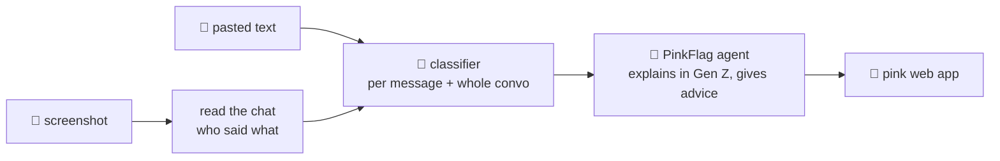

<div align="center">

# 🎀 PinkFlag 🎀

### your AI big sister for safer dating 🚩💅

**NLP + deep learning + LLM agent that detects manipulation and red flags in dating chats**

*paste a message (or soon, a screenshot of the whole convo) → PinkFlag tells you if it's giving 💚 green flag or 🚩 red flag, what kind, and why*


</div>

---

## 💅 what PinkFlag detects

| | label | what it means |
|---|---|---|
| 💚 | **green flag fr** | respectful, consistent, accountable |
| 💣 | **love bombing** | soulmate talk on date two, way too much way too fast |
| 🔥 | **gaslighting** | "that never happened", makes you doubt your own memory |
| ⛓️ | **controlling** | location checks, phone checks, "you're not wearing that" |
| 😢 | **guilt tripping** | "after everything i've done for you..." |
| 🙄 | **disrespect** | negging, insults, comparing you to his ex |
| 🍞 | **breadcrumbing** | "wyd" at 2am, "we should link fr" with no date ever |

Full definitions (what labelers follow) live in [`src/pinkflag/taxonomy.py`](src/pinkflag/taxonomy.py).

## ✨ try it

```bash
pip install -e ".[dev]"
python -m pinkflag.train                       # train + cross-validated scores
python -m pinkflag.predict "turn ur location back on rn"
```

```
"turn ur location back on rn"
🚩 RED FLAG  (all red-flag types combined: 95%)
   ⛓️ controlling                    76% ███████████████████
   🙄 disrespectful                   5% █
   💚 green flag fr                   5% █
```

## 🧠 how it works (the plan)



1. **Read the screenshot.** Pull the text out of the image and work out which bubbles are his and which are yours (left vs right side).
2. **Classify.** An ML model scores each message *and* the conversation as a whole, because patterns over time matter more than one text.
3. **PinkFlag talks.** An LLM agent takes the model's scores and explains them like a big sister would, quoting the exact messages that triggered each flag.
4. **Pink app.** Upload, get the verdict, see the receipts.

## 📈 current results (v0.1 baseline)

TF-IDF (words + characters) → Logistic Regression, 5-fold cross-validation on 185 hand-written messages:

| task | accuracy | macro-F1 |
|---|---|---|
| red flag vs green | 84% | 0.78 |
| which of the 7 types | 62% | 0.61 |

> ⚠️ **Read this before you get excited:** every message here was written by us, so these scores measure how well the model copies *our* writing style, not how well it works on real texts. A real-world test set is on the roadmap.

## 🛣️ roadmap

See [`docs/ROADMAP.md`](docs/ROADMAP.md). Short version:

- [x] **v0.1** baseline model, taxonomy, tests, CI
- [ ] **v0.2** real data: MentalManip + synthetic Gen Z conversations + labeling guide
- [ ] **v0.3** transformer model (fine-tuned DeBERTa), MLflow experiment tracking, DVC data versioning
- [ ] **v0.4** screenshot → conversation parser
- [ ] **v0.5** PinkFlag agent (LLM + classifier as a tool)
- [ ] **v0.6** pink web app (Next.js + FastAPI)
- [ ] **v1.0** deployed, monitored, model card published

## 🫶 the honest part

- PinkFlag spots **patterns in text**. She can't read minds, and a score isn't a verdict on a whole person.
- One text without context can mislead. "where are you?" is different at 2am from a worried partner.
- If something feels wrong, trust that feeling over any model. If you're in danger, reach out to a local helpline or someone you trust.
- Red flags aren't gendered. Anyone can show them.

## 📜 license

MIT
