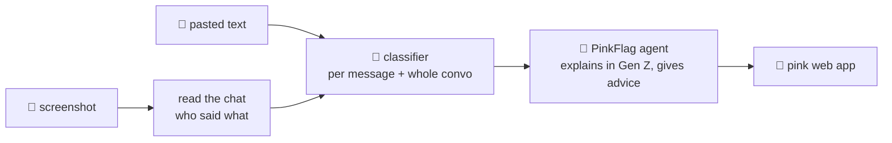

<div align="center">

# 🎀 PinkFlag 🎀

### your AI big sister for safer dating 🚩💅

**Get the receipts 💅 End-to-end NLP system: web scraping → multi-dataset training → TF-IDF / BiLSTM / fine-tuned XLM-RoBERTa → LLM agent with memory that explains manipulation patterns**

### 👉 [try it live: pinkflag-0lwy.onrender.com](https://pinkflag-0lwy.onrender.com) · [model on 🤗 Hub](https://huggingface.co/onsn/pinkflag-detector)

*paste a message (or a screenshot of the whole convo) → PinkFlag tells you if it's giving 💚 green flag or 🚩 red flag, what kind, and why*

[](https://github.com/onsnasr/pinkflag-ai-/actions/workflows/ci.yml)
[](https://github.com/onsnasr/pinkflag-ai-/actions/workflows/security.yml)


</div>

---

## 💅 what PinkFlag detects

| | label | what it means |
|---|---|---|
| 💚 | **green flag fr** | respectful, consistent, accountable |
| 💣 | **love bombing** | soulmate talk on date two, way too much way too fast |
| 🔥 | **gaslighting** | "that never happened", makes you doubt your own memory |
| ⛓️ | **controlling** | location checks, phone checks, "you're not wearing that" |
| 😢 | **guilt tripping** | "after everything i've done for you..." |
| 🙄 | **disrespect** | negging, insults, comparing you to his ex |
| 😡 | **intimidation / anger** | threats, CAPS-LOCK rage, "you'll regret this" |
| 🍞 | **breadcrumbing** | "wyd" at 2am, "we should link fr" with no date ever |

Full definitions (what labelers follow) live in [`src/pinkflag/taxonomy.py`](src/pinkflag/taxonomy.py).

## 💬 run the app

```bash
pip install -e ".[dev]"
cp .env.example .env            # add your GEMINI_API_KEY
python -m pinkflag.train --config configs/baseline_strong.yaml   # train the detector
python -m pinkflag.app          # open http://127.0.0.1:8000
```

Add the guys you're talking to, paste what they said, and Sisi answers with the receipts:
red flags detected by the model, a vibe meter per guy, a timeline, his mini profile (filled in
automatically as you talk), and **the roster** where a spin-the-wheel lands on the one who
treats you best. Everything stays on your computer (one SQLite file).

### 📞 Call Sisi (voice, 100% local)

```bash
pip install -e ".[voice]"
python -m piper.download_voices --download-dir models/voices en_US-amy-medium
```

Tap **📞 Call Sisi** → tap the mic, talk, tap again. **Whisper** (runs on your GPU) turns your voice
into text in any language, Sisi answers, and **Piper** speaks her reply out loud. No audio ever
leaves your computer.

## ✨ try the detector alone

```bash
pip install -e ".[dev]"
python -m pinkflag.train                       # train + cross-validated scores
python -m pinkflag.predict "turn ur location back on rn"
```

```
"turn ur location back on rn"
🚩 RED FLAG  (all red-flag types combined: 95%)
   ⛓️ controlling                    76% ███████████████████
   🙄 disrespectful                   5% █
   💚 green flag fr                   5% █
```

## 🧠 how it works (the plan)



1. **Read the screenshot.** Pull the text out of the image and work out which bubbles are his and which are yours (left vs right side).
2. **Classify.** An ML model scores each message *and* the conversation as a whole, because patterns over time matter more than one text.
3. **PinkFlag talks.** An LLM agent takes the model's scores and explains them like a big sister would, quoting the exact messages that triggered each flag.
4. **Pink app.** Upload, get the verdict, see the receipts.

## 📈 current results (v0.1 baseline)

TF-IDF (words + characters) → Logistic Regression, 5-fold cross-validation on 199 hand-written messages:

| task | accuracy | macro-F1 |
|---|---|---|
| red flag vs green | 85% | 0.78 |
| which of the 8 types | 57% | 0.54 |

**v0.2 merged dataset** (handwritten + scraped + MentalManip + machine-translated Derja, group-aware split, 1,416 train rows), same baseline:

| test set | type accuracy | red flag vs green |
|---|---|---|
| all | 46% | 79% |
| English | 48% | 79% |
| Derja (translated) | 38% | 79% |
| MentalManip dialogues | 43% | 77% |

Scores dropped vs v0.1, and that's the point: real, varied data exposes what word-counting can't do.

### v0.4: transformer + label-noise experiment
Fine-tuned **XLM-RoBERTa base** on an RTX 3050 (6 GB). Three runs with different settings all hit the same
~44% ceiling (run 1 undertrained, run 2 overfit, run 3 regularized with frozen layers, label smoothing and
early stopping on validation loss). **Error analysis** (`python -m pinkflag.error_analysis`) showed why:
most mistakes sat on *loosely mapped* labels (e.g. MentalManip "not manipulative" mapped to green flag,
while the dialogue is openly rude).

So we added a **clean test set** (only trusted labels: hand-written, strong mappings) and retrained on
trusted labels only:

| model | trained on | clean test accuracy | clean macro-F1 | red flag vs green |
|---|---|---|---|---|
| TF-IDF + LogReg | all labels (1,416) | 55% | 0.49 | 89% |
| XLM-RoBERTa | all labels (1,416) | 54% | 0.49 | 83% |
| XLM-RoBERTa | trusted labels (545) | 60% | 0.55 | 94% |
| **TF-IDF + LogReg** | **trusted labels (545)** | **66%** | **0.63** | **99%** |

**Takeaways:** cleaning the labels was worth more than switching to deep learning (+11 points for the
baseline). With only ~550 clean examples, the simpler model wins; the transformer needs more clean data
to pull ahead. The clean test set is small (103 rows), so differences of a few points are within noise.
Sisi now uses the best model.

### v0.5: three model families, one honest comparison
Same trusted training data (591 rows), same clean test set (n = 114), **95% bootstrap confidence intervals**
(`python -m pinkflag.evaluate`):

| Model | Accuracy | Macro-F1 | Red flag vs green |
|---|---|---|---|
| TF-IDF + LogReg (classical ML) | 61% (52-69) | 0.56 (0.43-0.67) | 97% (94-100) |
| BiLSTM from scratch (deep learning) | 39% (30-47) | 0.35 (0.26-0.42) | 93% (89-97) |
| **XLM-RoBERTa fine-tuned (transfer learning)** | **63% (54-72)** | **0.58 (0.46-0.67)** | 94% (89-97) |

- With ~600 examples, deep learning **from scratch** can't learn language (BiLSTM clearly worst).
  **Pre-training** fixes that: XLM-RoBERTa is the top model, though its interval overlaps the baseline's.
- A second annotator (Gemini) agreed with our loose dataset mappings only **33% (Cohen's κ = 0.15)**,
  quantifying the label noise found in error analysis; adding the agreed rows did not help (ablation).
- Full details, limitations and ethics: [`docs/MODEL_CARD.md`](docs/MODEL_CARD.md).

> ⚠️ **Read this before you get excited:** every message here was written by us, so these scores measure how well the model copies *our* writing style, not how well it works on real texts. A real-world test set is on the roadmap.

## 🧪 testing & security pipeline

Run it all locally before pushing with `python tools/check.py` (or `--fast` for lint + unit only). Every push then runs the same checks again in two GitHub Actions workflows, plus the DAST scan:

| layer | tool | what it checks |
|---|---|---|
| lint | ruff | style, bugs, unsafe patterns |
| unit + API | pytest (+ coverage) | models, data pipeline, agent loop with a fake Gemini, privacy between visitors, daily limit, security headers |
| end-to-end | Playwright | a real browser adds a guy, chats with Sisi, sees the receipts, deletes him, and fails on any CSP violation |
| SAST | Bandit + CodeQL | insecure Python and JavaScript (SQL built from strings, unpinned pickle downloads, unsafe `torch.load`...) |
| SCA | pip-audit + dependency review | known CVEs in every dependency of the hosted app, weekly too |
| secrets | Gitleaks | API keys that slipped into git history |
| DAST | OWASP ZAP baseline | attacks the exact Docker image that runs on Render |

## 🛣️ roadmap

See [`docs/ROADMAP.md`](docs/ROADMAP.md). Short version:

- [x] **v0.1** baseline model, taxonomy, tests, CI
- [ ] **v0.2** real data: MentalManip + synthetic Gen Z conversations + labeling guide
- [ ] **v0.3** transformer model (fine-tuned DeBERTa), MLflow experiment tracking, DVC data versioning
- [ ] **v0.4** screenshot → conversation parser
- [ ] **v0.5** PinkFlag agent (LLM + classifier as a tool)
- [ ] **v0.6** pink web app (Next.js + FastAPI)
- [ ] **v1.0** deployed, monitored, model card published

## 🫶 the honest part

- PinkFlag spots **patterns in text**. She can't read minds, and a score isn't a verdict on a whole person.
- One text without context can mislead. "where are you?" is different at 2am from a worried partner.
- If something feels wrong, trust that feeling over any model. If you're in danger, reach out to a local helpline or someone you trust.
- Red flags aren't gendered. Anyone can show them.

## 📜 license

MIT
